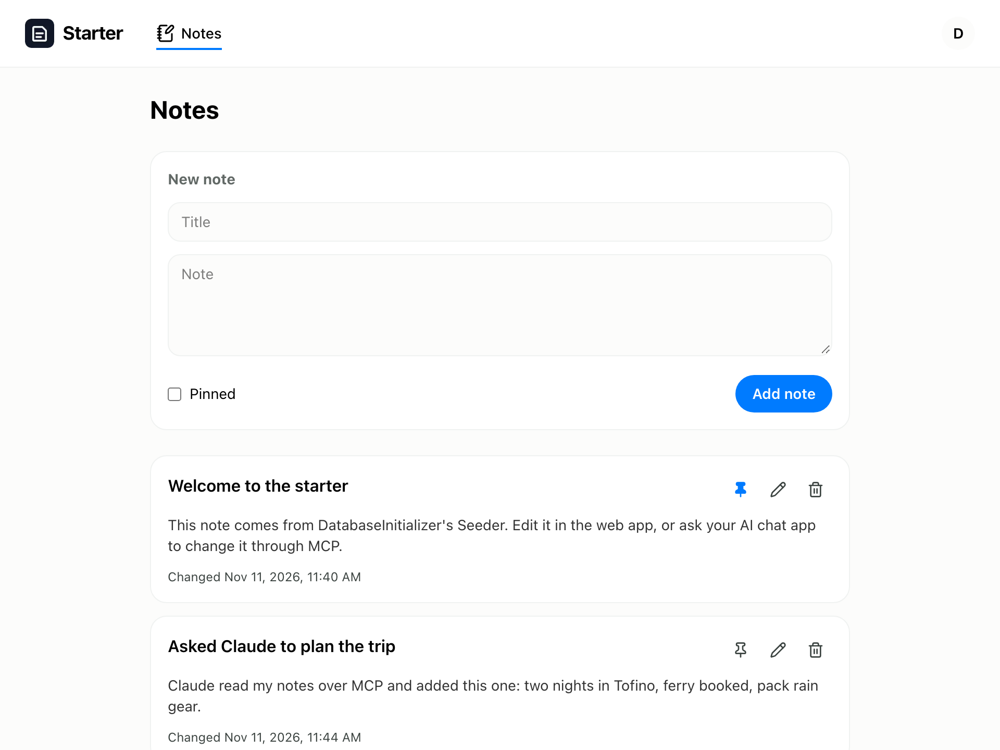
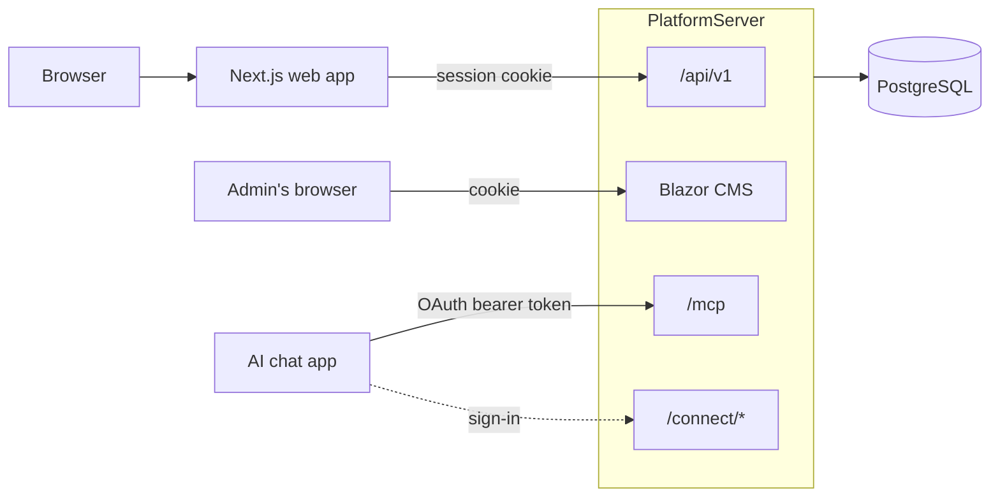

# dotnet-nextjs-starter

A full-stack starter with **.NET 10** on the server and **Next.js** on the web, plus a **Blazor CMS** and an
**MCP server** that AI chat apps like Claude sign in to with OAuth. It runs locally with one Docker Compose
command and deploys to a single VPS behind Caddy.

The example feature is **Notes**: each user's notes, which they can edit in the web app or through their AI chat
app.



## What's inside

| Part | Stack |
|---|---|
| API | ASP.NET Core Minimal APIs on .NET 10, EF Core and PostgreSQL, API versioning, an OpenAPI document with Scalar |
| Accounts | ASP.NET Core Identity: sign-up with email confirmation, password reset, account deletion by emailed code, lockout, rate limits, optional Cloudflare Turnstile |
| CMS | Blazor Server, with an admin home page, a Notes page and a test-email page |
| MCP | The [MCP C# SDK](https://github.com/modelcontextprotocol/csharp-sdk) over streamable HTTP, signed in with OAuth 2.1 + PKCE from an OpenIddict server in the same app; role-gated tools and a prompt |
| Web | Next.js 16, React 19, Tailwind 4, with API types generated from the OpenAPI document; the session cookie stays on the Next.js server |
| Email | SMTP through MailKit, with a background queue; Mailpit locally |
| Ops | Docker Compose for local and production, a Caddyfile example, GitHub Actions CI (build, test, lint, formatting, Trivy scans), Dependabot, Sentry (optional) |
| Tests | 140+ xUnit tests that run the whole API in memory on SQLite, including the OAuth flow and MCP calls |



## Quick start

You need Docker, the [.NET 10 SDK](https://dotnet.microsoft.com/download) (for tests and migrations) and Node 22+.

```bash
docker compose -f server/docker-compose.local.yml up -d --build   # Postgres, migrations + seed data, Mailpit, API
npm --prefix web ci
npm --prefix web run dev                                          # http://localhost:3000
```

- **Web app:** http://localhost:3000. Sign in as `demo@example.com` / `Demopassword1@`, or sign up; the
  confirmation email lands in Mailpit at http://localhost:8025.
- **CMS:** http://localhost:8080. Sign in as `admin@example.com` / `Adminpassword1@`.
- **API reference:** http://localhost:8080/scalar/v1
- **MCP:** http://localhost:8080/mcp. Try it with MCP Inspector ([docs/mcp.md](docs/mcp.md)).

These passwords are for local use only. Production seeds no demo user and takes the admin's from your `.env`.

Ports already taken? Set `API_PORT`, `POSTGRES_PORT`, `MAILPIT_PORT`, `MAILPIT_SMTP_PORT` and `WEB_PORT` in
`server/.env`, and run the web app with `API_BASE_URL=http://localhost:<API_PORT> npm --prefix web run dev -- -p <WEB_PORT>`.

## Layout

```
server/                     the .NET solution (Starter.sln)
  src/PlatformServer/       API, Blazor CMS, OAuth server and MCP endpoint, one ASP.NET Core app
    Features/               one folder per feature: Account, Auth, Email, Notes, Mcp
    Components/             the CMS's Blazor pages
  src/DataLibrary/          EF Core: the DbContext, entities and migrations
  src/DatabaseInitializer/  applies migrations and seeds roles, the admin, the MCP clients and demo data
  src/SharedLibrary/        exceptions and limits shared by the projects
  tests/PlatformServer.Tests/
web/                        the Next.js app
  src/app/                  pages and the route handlers that relay writes to the API
  src/lib/api.ts            server-side reads, as the signed-in user
  openapi.json, src/lib/api-types.ts   generated from the server
docs/                       architecture, MCP, deployment, reference
```

## Add your own feature

Notes runs through every layer, so the quickest way to add a feature is to copy its path. The steps are in
[docs/architecture.md](docs/architecture.md#adding-a-feature).

## Docs

- [Architecture](docs/architecture.md): how a request is signed in, the layers, and adding a feature
- [MCP](docs/mcp.md): the endpoint, its OAuth sign-in, and connecting Claude and MCP Inspector
- [Deployment](docs/deployment.md): one VPS with Docker Compose and Caddy
- [Reference](docs/reference.md): migrations, the OpenAPI document, tests and Docker commands

`CLAUDE.md` files at the root, in `server/` and in `web/` describe the conventions for AI coding agents, and
work as a short guide for people too.

## License

[MIT](LICENSE)
